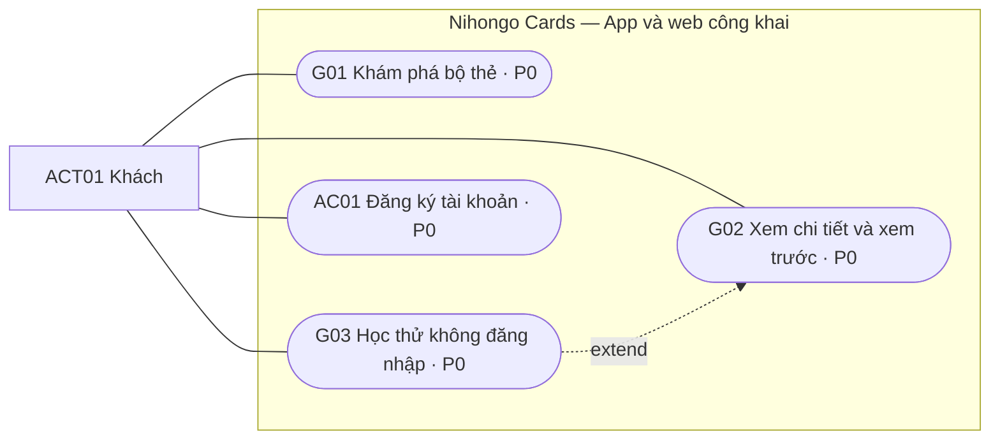
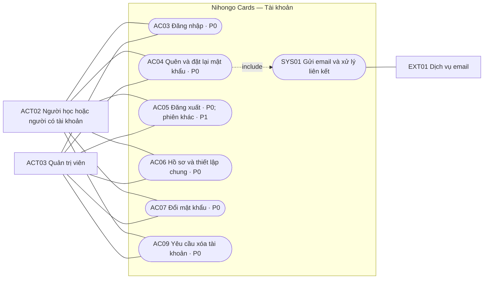
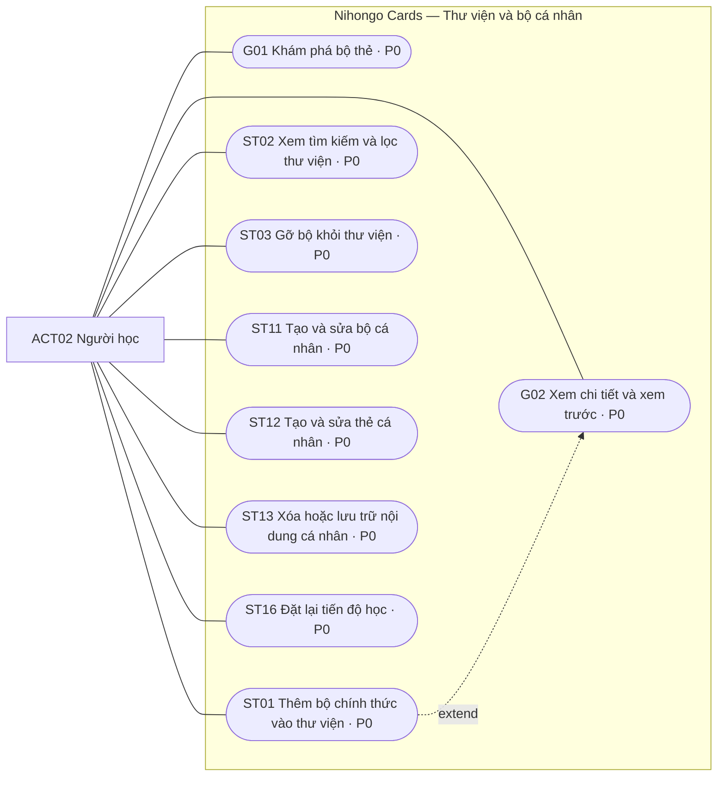
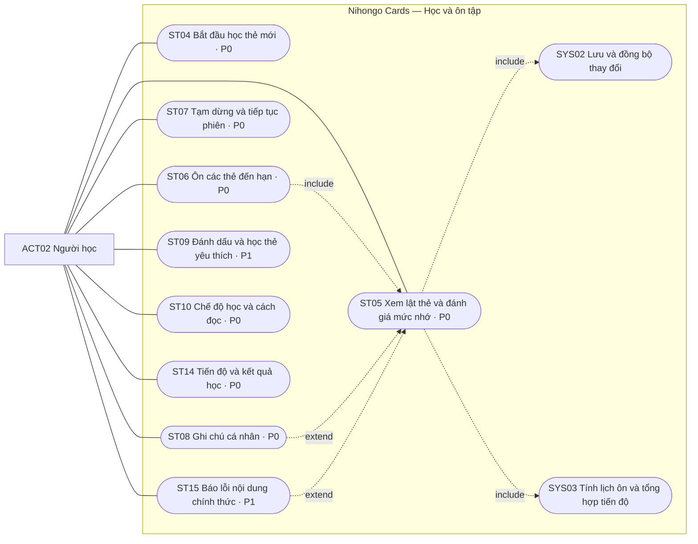
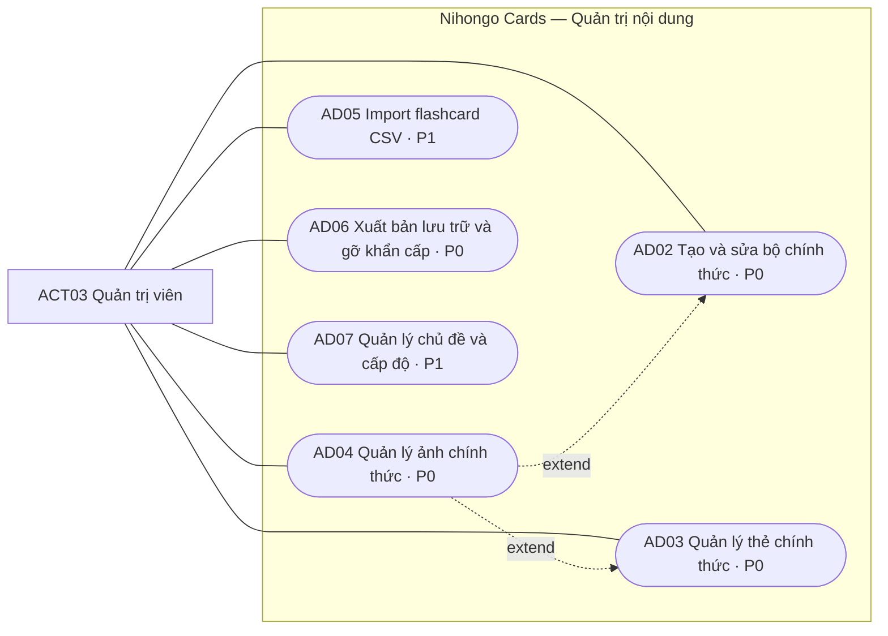
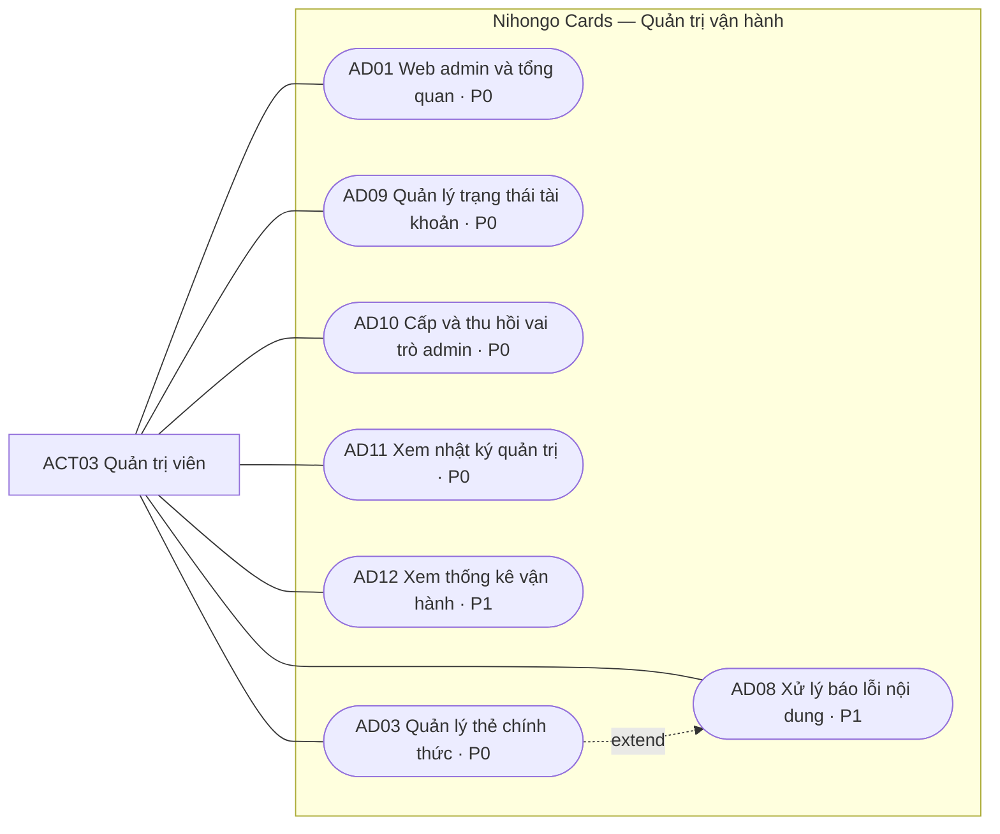

# Sơ đồ use case ứng dụng flashcard tiếng Nhật

**Ngày cập nhật:** 19/11/2026  
**Tài liệu nghiệp vụ:** [flashcard-use-cases.md](./flashcard-use-cases.md)

Sơ đồ bao phủ **38 use case hiện hành P0 và P1**, cùng **3 tiến trình hỗ trợ**. AC02 xác minh email được hoãn sang P2 nên không nằm trong sơ đồ hiện hành. Chức năng đổi email đăng nhập đã được loại bỏ.

Đăng ký thành công tạo tài khoản hoạt động ngay; người dùng đăng nhập và học mà không cần xác nhận email. App và web người học dùng chung nghiệp vụ; quản trị được thực hiện trên web admin.

## 1 Quy ước

Mermaid chưa có cú pháp UML use case chuyên biệt; tài liệu dùng flowchart với hình bầu dục để biểu diễn use case và khung subgraph làm ranh giới hệ thống.

| Ký hiệu | Ý nghĩa |
|---|---|
| Nút chữ nhật ngoài ranh giới | Tác nhân tương tác với hệ thống |
| Nút bầu dục bên trong ranh giới | Use case hoặc tiến trình hỗ trợ có mã tham chiếu |
| Đường liền không mũi tên | Tác nhân tham gia use case, không biểu diễn thứ tự thực hiện |
| Mũi tên nét đứt include | Use case nguồn luôn gọi hành vi dùng chung ở đích |
| Mũi tên nét đứt extend | Hành vi nguồn có thể bổ sung vào use case đích khi thỏa điều kiện |
| P0 hoặc P1 trong nhãn | Mức ưu tiên triển khai; không phải quyền truy cập |

Đăng nhập là **điều kiện trước** của các chức năng riêng tư, không phải thao tác phải thực hiện lại trong mỗi use case. Vì vậy không nối tất cả use case với AC03 bằng include.

SYS01 đến SYS03 là tiến trình nội bộ dùng chung, không phải vai trò người dùng. Dịch vụ email EXT01 nằm ngoài hệ thống. Các quan hệ include đến SYS02 và SYS03 ở sơ đồ học chỉ xét nhánh đánh giá được backend chấp nhận.

## 2 Khách khám phá và đăng ký

- Học thử là lựa chọn khi xem chi tiết bộ thẻ; không ghi tiến độ chính thức.
- AC01 không gọi tiến trình gửi email xác minh. Sau khi đăng ký, người dùng có thể thực hiện AC03 ngay.
- Khách chọn Thêm vào thư viện được yêu cầu đăng nhập rồi quay lại ST01; đây là điều hướng, không phải quan hệ include giữa đăng ký và thêm bộ.

## 3 Tài khoản dùng chung cho người học và admin

- Người chưa đăng nhập vẫn có thể dùng AC04 để lấy lại mật khẩu; nhãn Người học ở đây chỉ người sở hữu tài khoản, không khẳng định đã có phiên hợp lệ.
- Admin chỉ sửa hồ sơ, mật khẩu hoặc yêu cầu xóa **tài khoản của chính mình** trong các use case tài khoản.
- Admin hoạt động cuối cùng phải chuyển quyền trước khi xóa tài khoản.
- SYS01 ở phạm vi hiện tại phục vụ khôi phục mật khẩu; không gửi email xác minh đăng ký.

## 4 Người học quản lý thư viện và nội dung riêng

- Người học có thể khám phá nội dung công khai; G01 được dùng lại với cùng nội dung công khai như khách.
- ST01 là lựa chọn thêm bộ từ trang chi tiết. Thêm lại bộ đã gỡ khôi phục tiến độ cũ.
- ST03 chỉ gỡ bộ chính thức khỏi thư viện; ST13 quản lý nội dung do người học sở hữu.
- ST16 chỉ reset tiến độ của chính người học, có xác nhận riêng và giữ ghi chú cá nhân.
- ST12 hỗ trợ Kanji, dòng cách đọc Hiragana, nghĩa, ảnh, ví dụ và ghi chú nội dung. Thẻ chữ hoặc ảnh thông thường không bắt buộc phải có Kanji.

## 5 Người học học ôn và theo dõi tiến độ

- ST04 tạo phiên; ST05 thực hiện từng lượt học. Không dùng include để biểu diễn thứ tự chuyển từ màn hình cấu hình sang thẻ học.
- Trong phiên ôn có thẻ đến hạn, ST06 dùng lại thao tác ST05. Nếu không có thẻ đến hạn, kết thúc ở trạng thái rỗng theo luồng ngoại lệ.
- Ghi chú và báo lỗi có thể được mở khi xem thẻ; chúng không bắt buộc trong mỗi lượt học. ST15 chỉ áp dụng cho thẻ chính thức.
- SYS02 và SYS03 được thực hiện khi đánh giá được chấp nhận. Chỉ lật thẻ hoặc mở Hiragana không làm cập nhật lịch ôn.
- SYS02 còn được dùng khi lưu thư viện, nội dung và ghi chú; sơ đồ chỉ vẽ quan hệ trong luồng đánh giá để giữ dễ đọc.
- ST10 cho chọn hiện hoặc ẩn Hiragana, hiện khi chạm, mặt trước và số lượng thẻ. Chế độ khác nhau không tạo bản sao tiến độ của cùng một thẻ.

## 6 Admin quản lý nội dung chính thức

- Upload hoặc thay ảnh là hành vi tùy chọn khi sửa bộ hoặc thẻ; admin cũng có thể quản lý ảnh chính thức độc lập.
- Import tạo thẻ nháp, không tự xuất bản. AD06 chỉ cho xuất bản nội dung đủ điều kiện.
- Lưu trữ bộ dừng khám phá và thêm mới nhưng giữ quyền học của người đã theo học; gỡ khẩn cấp dừng cấp nội dung cho mọi người.
- Sửa lỗi ở thẻ đã học giữ định danh, tiến độ và ghi chú. Chuyển thành kiến thức khác phải tạo thẻ mới.

## 7 Admin quản lý vận hành và quyền

- Trong AD08, sửa thẻ qua AD03 là tùy chọn khi báo lỗi cần điều chỉnh nội dung; cũng có thể kết thúc bằng kết quả Không điều chỉnh hoặc Trùng.
- AD11 là use case **xem** audit. Ghi audit là yêu cầu nội bộ khi thực hiện thao tác nhạy cảm, không có quan hệ include đến use case xem nhật ký.
- Admin không được đọc bộ riêng hoặc ghi chú cá nhân của người khác, không xem mật khẩu và không reset tiến độ thay người học.
- Không được khóa, xóa hoặc thu hồi vai trò của admin hoạt động cuối cùng.
- Admin có thể dùng các chức năng người học cho dữ liệu của chính mình. Quyền quản trị không mở rộng quyền sở hữu dữ liệu cá nhân.

## 8 Đối chiếu phạm vi

| Sơ đồ | Mã được thể hiện | Số use case chính không tính lặp |
|---|---|---|
| Khách | G01, G02, G03, AC01 | 4 |
| Tài khoản chung | AC03, AC04, AC05, AC06, AC07, AC09 | 6 |
| Thư viện và nội dung riêng | ST01, ST02, ST03, ST11, ST12, ST13, ST16; dùng lại G01 và G02 | 7 |
| Học và ôn | ST04, ST05, ST06, ST07, ST08, ST09, ST10, ST14, ST15 | 9 |
| Quản trị nội dung | AD02, AD03, AD04, AD05, AD06, AD07 | 6 |
| Quản trị vận hành | AD01, AD08, AD09, AD10, AD11, AD12; dùng lại AD03 | 6 |
| Tổng | Toàn bộ phạm vi P0 và P1 hiện hành | 38 |
| Tiến trình hỗ trợ | SYS01 ở sơ đồ tài khoản; SYS02 và SYS03 ở sơ đồ học | 3 tiến trình, tính riêng |

AC02 vẫn nằm trong tài liệu nghiệp vụ để tham khảo ở P2, không tạo màn hình chờ xác minh hay điều kiện chặn đăng nhập hiện tại. Mã use case được giữ nguyên để liên kết với đặc tả và task phát triển.
